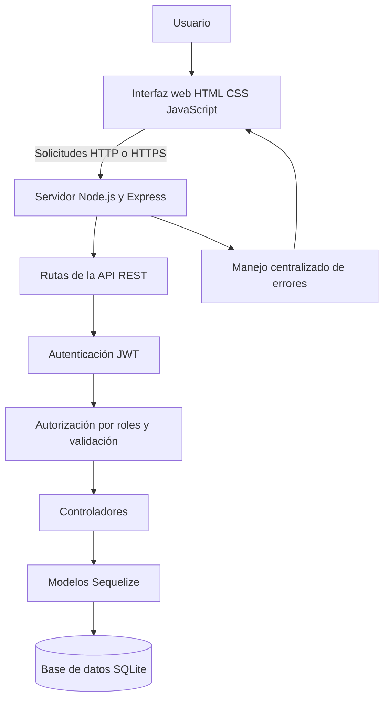
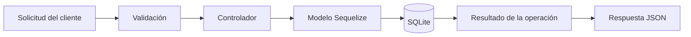

# CyberMonitor — Plataforma de gestión de incidentes de ciberseguridad

**Proyecto integrador de Desarrollo de Plataformas**  
**Periodo:** Octubre de 2026  
**Estudiante:** Alisson Valeria Defaz Montero

**Aplicación publicada:** https://plataforma-incidentes.onrender.com

---

## 1. Introducción

CyberMonitor es una aplicación web que desarrollé como proyecto académico para centralizar el registro, la consulta y el seguimiento de incidentes de ciberseguridad. Su propósito es facilitar la organización de la información y permitir que las operaciones se realicen de acuerdo con los permisos asignados a cada usuario.

El proyecto integra una interfaz web, una API REST desarrollada con Node.js y Express, una base de datos y mecanismos de seguridad para proteger las operaciones. Durante su desarrollo trabajé con operaciones CRUD, autenticación mediante JWT, control de roles, validación de datos y manejo de errores.

Este documento explica la arquitectura, las tecnologías utilizadas, la configuración, los endpoints, los controles de seguridad y las formas de probar y ejecutar el sistema.

## 2. Objetivos del proyecto

### 2.1 Objetivo general

Desarrollar una plataforma web para gestionar incidentes de ciberseguridad mediante una API REST, almacenamiento persistente y controles de autenticación, autorización y validación.

### 2.2 Objetivos específicos

- Implementar operaciones para crear, consultar, actualizar y eliminar incidentes.
- Conectar la API con una base de datos mediante Sequelize.
- Proteger las rutas privadas mediante tokens JWT.
- Aplicar permisos de acuerdo con el rol del usuario.
- Validar los datos recibidos para reducir errores de entrada.
- Centralizar el tratamiento de errores y devolver respuestas HTTP coherentes.
- Documentar la instalación, configuración, pruebas y despliegue.

## 3. Tecnologías utilizadas

| Tecnología | Función dentro del proyecto |
|---|---|
| Node.js | Ejecutar el servidor en JavaScript |
| Express | Crear el servidor web y las rutas de la API REST |
| JavaScript, HTML y CSS | Construir la interfaz y su comportamiento |
| Sequelize | Facilitar la comunicación con la base de datos |
| SQLite | Almacenar información en la configuración local |
| JSON Web Token (JWT) | Autenticar solicitudes a rutas protegidas |
| bcryptjs | Generar y verificar hashes de contraseñas |
| express-validator | Validar y sanitizar datos recibidos |
| Helmet | Añadir cabeceras HTTP de seguridad |
| CORS | Controlar los orígenes que pueden realizar solicitudes |
| Jest | Ejecutar pruebas automatizadas |
| ESLint | Revisar la calidad y consistencia del código |
| Render | Alojar la versión publicada de la aplicación |

## 4. Arquitectura del sistema

CyberMonitor utiliza una arquitectura cliente-servidor. El usuario interactúa con la interfaz web, que envía solicitudes HTTP al servidor Express. Las rutas aplican los controles correspondientes y derivan las operaciones a los controladores y modelos. Sequelize permite acceder a la base de datos.

### 4.1 Diagrama de arquitectura



### 4.2 Organización de los archivos

| Archivo o carpeta | Responsabilidad |
|---|---|
| `server.js` | Configura Express, registra los middlewares y las rutas e inicia el servidor |
| `public/` | Contiene la interfaz web, scripts y estilos |
| `routes/` | Define las rutas de autenticación e incidentes |
| `controllers/` | Coordina las operaciones de la aplicación |
| `models/` | Define los modelos de datos mediante Sequelize |
| `middleware/auth.js` | Verifica tokens JWT y permisos por rol |
| `middleware/validacion.js` | Valida los datos de entrada |
| `middleware/errorHandler.js` | Centraliza el tratamiento de errores |
| `middleware/logger.js` | Registra información de las solicitudes |
| `migrations/` | Contiene scripts para crear o modificar la estructura de la base de datos |
| `seeders/` | Contiene datos iniciales o de demostración |
| `tests/` | Contiene pruebas automatizadas |
| `utils/` | Reúne funciones y reglas reutilizables |
| `scripts/` | Incluye utilidades auxiliares, como mediciones de rendimiento |
| `config/` | Contiene configuración de la base de datos y Sequelize |
| `.env.example` | Presenta las variables necesarias sin incluir secretos reales |
| `HTTPS.md` | Documenta consideraciones relacionadas con HTTPS |
| `package.json` | Define las dependencias y los comandos del proyecto |

## 5. Funcionalidades principales

La plataforma está orientada a las siguientes funciones:

1. **Autenticación:** permite iniciar sesión con credenciales válidas.
2. **Consulta de incidentes:** permite obtener los incidentes registrados.
3. **Creación de incidentes:** permite registrar información nueva con un rol autorizado.
4. **Actualización:** permite modificar los datos de un incidente.
5. **Eliminación controlada:** restringe la eliminación de registros según el rol.
6. **Validación:** comprueba que los datos cumplan las reglas configuradas.
7. **Persistencia:** utiliza Sequelize para acceder a la base de datos.
8. **Manejo de errores:** devuelve mensajes y códigos HTTP para comunicar los resultados de las solicitudes.

### 5.1 Datos de un incidente

| Campo | Descripción |
|---|---|
| `id` | Identificador del incidente |
| `tipo` | Categoría, por ejemplo, phishing o malware |
| `severidad` | Nivel de impacto o prioridad |
| `estado` | Situación actual del incidente |
| `fecha` | Fecha asociada al incidente |
| `responsable` | Persona encargada del seguimiento |
| `descripcion` | Detalle del evento reportado |

Los valores aceptados y los campos obligatorios deben corresponder a las reglas definidas en el modelo y en la validación del servidor.

## 6. API REST

La API permite que el cliente se comunique con el servidor mediante métodos HTTP. Las rutas de incidentes están protegidas y requieren un token JWT válido.

### 6.1 Rutas de autenticación

| Método | Endpoint | Descripción | Acceso |
|---|---|---|---|
| `POST` | `/api/auth/registro` | Registrar una cuenta | Público, sujeto a validaciones |
| `POST` | `/api/auth/login` | Verificar credenciales e iniciar sesión | Público |

El servidor debe determinar el rol autorizado para una cuenta. No se debe confiar en un rol privilegiado enviado libremente desde el navegador.

### 6.2 Rutas de incidentes

| Método | Endpoint | Función | Permiso requerido |
|---|---|---|---|
| `GET` | `/api/incidentes` | Consultar todos los incidentes | Token JWT válido |
| `GET` | `/api/incidentes/:id` | Consultar un incidente específico | Token JWT válido |
| `POST` | `/api/incidentes` | Crear un incidente | `ADMIN` o `ANALISTA` |
| `PUT` | `/api/incidentes/:id` | Actualizar un incidente | `ADMIN` o `ANALISTA` |
| `PATCH` | `/api/incidentes/:id` | Actualizar parcialmente un incidente | `ADMIN` o `ANALISTA` |
| `DELETE` | `/api/incidentes/:id` | Eliminar un incidente | `ADMIN` |

### 6.3 Ruta de comprobación de salud

| Método | Endpoint | Descripción |
|---|---|---|
| `GET` | `/health` | Comprueba el estado del servidor y la conexión con la base de datos |

La ruta `/health` permite revisar si la aplicación puede conectarse a la base de datos. Una respuesta satisfactoria debe mostrar el estado correcto del servicio.

### 6.4 Códigos HTTP utilizados

| Código | Significado |
|---|---|
| `200 OK` | Solicitud procesada correctamente |
| `201 Created` | Recurso creado correctamente |
| `400 Bad Request` | Datos incorrectos o validación fallida |
| `401 Unauthorized` | Falta un token válido o las credenciales son incorrectas |
| `403 Forbidden` | El usuario no tiene permisos suficientes |
| `404 Not Found` | Recurso no encontrado |
| `409 Conflict` | Conflicto con un recurso existente, por ejemplo un usuario duplicado |
| `500 Internal Server Error` | Error inesperado del servidor |
| `503 Service Unavailable` | Servicio temporalmente no disponible, por ejemplo por un fallo de conexión con la base de datos |

El código devuelto puede variar según la operación y el error. Las evidencias deben mostrar las respuestas obtenidas durante las pruebas reales.

## 7. Base de datos y persistencia

La capa de datos utiliza Sequelize como ORM. Esto permite definir modelos y realizar operaciones sin escribir manualmente todas las consultas SQL.

En la configuración local se utiliza SQLite, una base de datos basada en archivos. El proyecto incluye carpetas de migraciones y seeders para organizar la creación de estructuras y la carga de datos de ejemplo.

### Flujo de persistencia



La persistencia debe verificarse creando un incidente, reiniciando el servicio y consultando nuevamente el registro. En producción también es importante confirmar que el alojamiento utilice almacenamiento persistente para evitar la pérdida de archivos de base de datos cuando el servicio se reinicia o se recrea.

## 8. Seguridad de la aplicación

La seguridad es importante porque los incidentes pueden contener información sensible. Por esta razón, el proyecto incorpora controles en el servidor.

| Control | Función |
|---|---|
| JWT | Comprueba la identidad autenticada en las solicitudes protegidas |
| Roles | Restringe las operaciones según los permisos asignados |
| Hash de contraseñas | Evita guardar las contraseñas directamente en texto plano |
| Validación de datos | Rechaza entradas que no cumplen las reglas |
| Sanitización | Limpia determinadas entradas según las reglas configuradas |
| Helmet | Añade cabeceras de seguridad HTTP |
| CORS | Limita los orígenes permitidos según la configuración |
| Manejo de errores | Evita depender de respuestas improvisadas en cada ruta |
| Variables de entorno | Permite separar secretos y configuración del código |

### Buenas prácticas

- No subir el archivo `.env` al repositorio ni incluirlo en el ZIP de entrega.
- Utilizar un secreto JWT largo, aleatorio y privado.
- Cambiar las credenciales iniciales antes de compartir el entorno.
- No publicar contraseñas ni tokens en capturas, informes o videos.
- Utilizar HTTPS en el entorno publicado.
- Mantener actualizadas las dependencias.
- Definir respaldos y verificar la persistencia de la base de datos.
- Revisar los permisos antes de realizar operaciones de eliminación.

## 9. Instalación y ejecución local

### 9.1 Requisitos

- Node.js y npm en versiones compatibles con el proyecto.
- Visual Studio Code u otro editor.
- Una terminal de comandos.
- Los archivos del proyecto.

### 9.2 Instalar dependencias

Abra la carpeta del proyecto en Visual Studio Code y ejecute:

```bash
npm install
```

Este comando instala las dependencias declaradas en `package.json`.

### 9.3 Configurar las variables de entorno

1. Copie `.env.example`.
2. Cambie el nombre de la copia a `.env`.
3. Edite el archivo y reemplace los valores de ejemplo por valores privados.

| Variable | Propósito |
|---|---|
| `PORT` | Puerto local del servidor |
| `JWT_SECRET` | Secreto utilizado para firmar y verificar tokens |
| `JWT_EXPIRES_IN` | Tiempo de vigencia del token |
| `ADMIN_INITIAL_USERNAME` | Nombre de usuario inicial del administrador |
| `ADMIN_INITIAL_PASSWORD` | Contraseña inicial del administrador |
| `FRONTEND_URL` | Origen del cliente, si la configuración lo utiliza |
| `DB_DIALECT` | Motor de base de datos, si está configurado |
| `DB_STORAGE` | Ruta de almacenamiento de SQLite, si está configurada |

No utilice las palabras de ejemplo como credenciales reales. No comparta el archivo `.env`.

### 9.4 Iniciar el servidor

```bash
npm start
```

Si la configuración es correcta, el servidor iniciará y tratará de establecer la conexión con la base de datos.

### 9.5 Abrir la aplicación

En un navegador, acceda a:

- Interfaz local: `http://localhost:3000/`
- Estado del servidor: `http://localhost:3000/health`
- API de incidentes: `http://localhost:3000/api/incidentes`

La API de incidentes requiere un token JWT válido. Si se abre directamente sin iniciar sesión o sin enviar el token, debe rechazarse la solicitud.

## 10. Pruebas y validación

El proyecto incluye pruebas automatizadas y comandos de revisión definidos en `package.json`. Las pruebas ayudan a comprobar las reglas de negocio y a detectar errores antes de realizar cambios o despliegues.

### 10.1 Comandos disponibles

| Comando | Propósito |
|---|---|
| `npm test` | Ejecuta las pruebas configuradas con Jest |
| `npm run lint` | Ejecuta ESLint sobre las rutas configuradas en el proyecto |
| `npm run lint:fix` | Intenta corregir automáticamente algunos problemas detectados por ESLint |
| `npm run perf:api` | Ejecuta el script de medición de solicitudes |
| `npm start` | Inicia el servidor |

### 10.2 Casos de prueba recomendados

| N.º | Prueba | Resultado esperado |
|---:|---|---|
| 1 | Consultar la API sin token | Acceso rechazado con `401` |
| 2 | Iniciar sesión con credenciales válidas | Inicio de sesión correcto y entrega de token |
| 3 | Iniciar sesión con credenciales incorrectas | Acceso rechazado |
| 4 | Crear un incidente válido con rol autorizado | Incidente registrado |
| 5 | Enviar datos inválidos | Error de validación |
| 6 | Consultar un incidente existente | Se devuelve la información del registro |
| 7 | Intentar eliminar con rol sin permiso | Operación rechazada |
| 8 | Consultar `/health` | Estado del servidor y base de datos informado |

Estos casos son una guía de validación. En el informe de pruebas se deben registrar el procedimiento, el resultado real y la evidencia correspondiente. No se debe afirmar que una prueba pasó sin haberla ejecutado.

### 10.3 Rendimiento

El proyecto incluye el comando `npm run perf:api` para ejecutar el script de medición disponible. Las mediciones deben interpretarse como resultados del entorno donde se ejecutan. Para comparar el rendimiento antes y después de una mejora, se deben utilizar las mismas condiciones, repetir las pruebas y registrar los valores obtenidos.

## 11. Despliegue en Render

La versión publicada de CyberMonitor se encuentra en:

**https://plataforma-incidentes.onrender.com**

Para mantener el despliegue se recomienda:

1. Configurar las variables de entorno directamente en el panel del servicio.
2. Confirmar que el comando de inicio sea `npm start`.
3. No publicar secretos en el repositorio.
4. Revisar la ruta `/health`.
5. Iniciar sesión y probar las operaciones permitidas.
6. Comprobar que las operaciones no autorizadas sean rechazadas.
7. Confirmar que el almacenamiento de la base de datos sea persistente.

El uso de una URL HTTPS permite cifrar la comunicación entre el navegador y el servicio publicado. La configuración del certificado TLS depende del proveedor de alojamiento.

## 12. Limitaciones y mejoras futuras

Aunque el proyecto permite demostrar los conceptos principales de una aplicación de gestión de incidentes, todavía existen aspectos que conviene revisar antes de utilizarlo en una organización real:

- Ampliar las pruebas de integración y seguridad.
- Comprobar la persistencia y establecer respaldos de la base de datos en producción.
- Revisar la duración, almacenamiento y renovación de los tokens.
- Evitar que los registros de la aplicación expongan información sensible.
- Realizar pruebas de carga reproducibles y documentar sus resultados.
- Mantener las dependencias actualizadas.
- Establecer un proceso controlado de actualización del esquema de base de datos.
- Incorporar monitoreo y alertas si el sistema se utiliza de forma continua.

Estas mejoras permitirían aumentar la confiabilidad, seguridad y mantenibilidad de la plataforma.

## 13. Conclusión

El desarrollo de CyberMonitor me permitió integrar conocimientos de desarrollo web, API REST, bases de datos, autenticación, autorización, validación y pruebas. También me ayudó a comprender que una aplicación no se evalúa solamente por su interfaz, sino por la forma en que procesa los datos, protege las operaciones y responde ante errores.

La documentación reúne la información necesaria para comprender la estructura del sistema y ejecutar sus funciones principales. Las evidencias de funcionamiento y los resultados de las pruebas deben corresponder a comprobaciones reales realizadas durante el desarrollo y la validación.

## 14. Referencia rápida

| Recurso | Dirección o ubicación |
|---|---|
| Plataforma publicada | https://plataforma-incidentes.onrender.com |
| Estado del servidor | `/health` |
| Autenticación | `/api/auth` |
| Incidentes | `/api/incidentes` |
| Variables de ejemplo | `.env.example` |
| Pruebas | `tests/` |
| Documentación HTTPS | `HTTPS.md` |

---

**Fin de la documentación técnica de CyberMonitor.**
